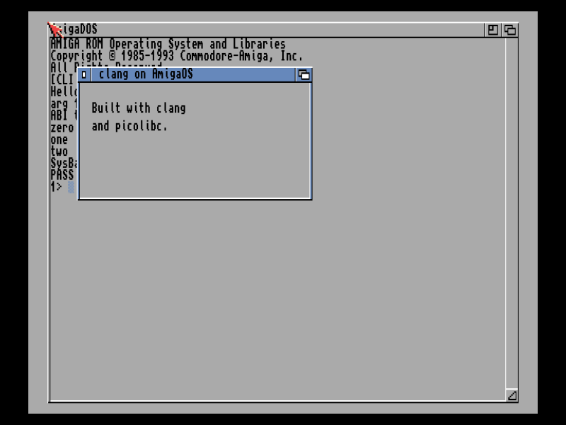

---
hide:
  - navigation
---

# Amiga SDK

<!-- include README.md "" -->

```sh
clang --target=m68k-amigaos -O2 hello.c -o hello
clang --target=m68k-amigaos -mcpu=68020 -O2 window.c -o window
```

<div class="grid cards" markdown>

-   :material-rocket-launch: **Write programs**

    ---

    [C programs, OS calls and the link library functions](using.md): what works as in POSIX and how to call the OS.

-   :material-file-tree: **The headers**

    ---

    [The AmigaOS headers and libamiga.a](headers.md): where they come from and how they match the NDK.

-   :material-test-tube: **Run and test**

    ---

    [vamos, FS-UAE and the test suite](testing.md), on Kickstart 1.3 to 3.1.

-   :material-download: **Get it**

    ---

    The sysroot ships in the [clang-dos toolchain package](https://clang-retro.github.io/dos-sdk/toolchain/), or [build it yourself](building.md).

</div>

<figure markdown>
{ width="720" }
<figcaption>A picolibc program and its window on Kickstart 3.1 (A1200, FS-UAE).</figcaption>
</figure>
